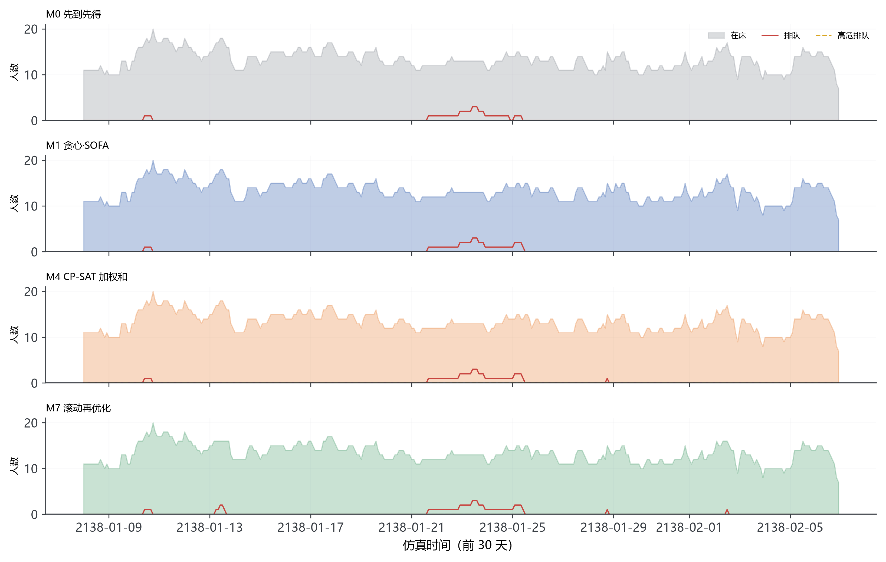
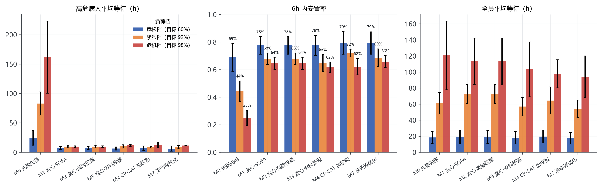
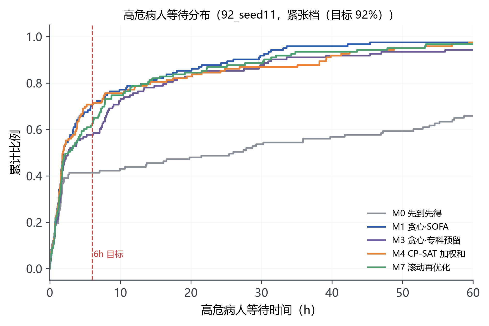
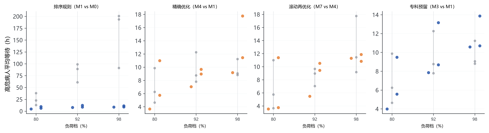
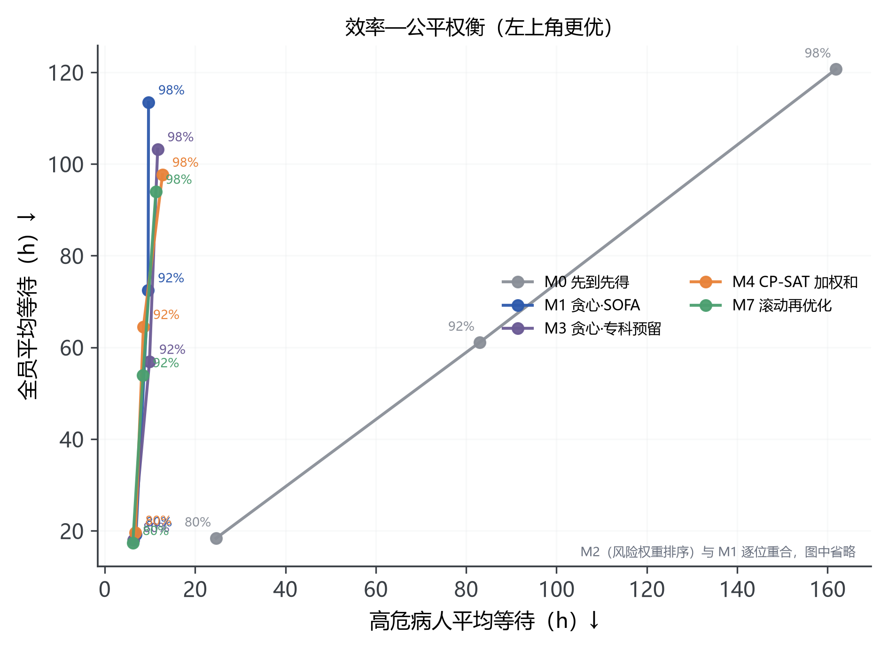
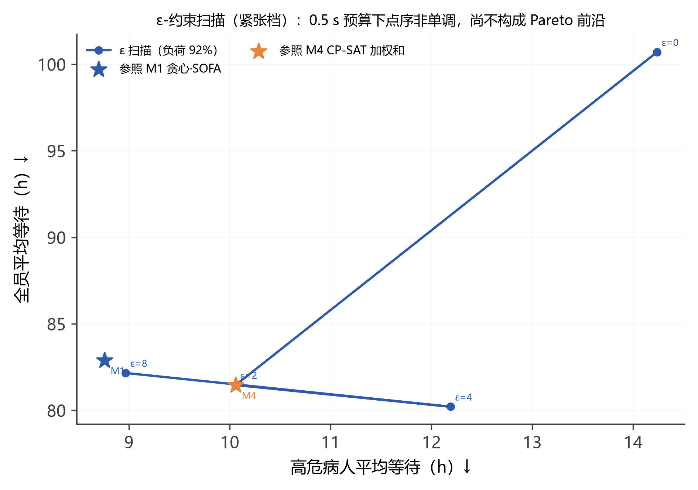

<!-- 由 src/make_section.py 自动生成，tag=_g2，2026-11-13 13:26:03；请勿手改数字 -->

# 5  调度实验：20 床 ICU 的滚动床位分配

> 数据来源：`results/bench_raw_g2.csv`（每个场景-方法一条轨迹）、`table_sched.csv`、`pairwise_sched.csv`、`metrics_sched.json`。图表：`experiments/figures/scheduling/`（300 dpi）。本文件由脚本生成，数字不手打；`src/verify.py` 会核对可溯源性。

## 5.1  仿真设定：同一份到达流，只换决策规则

调度问题只有一句话：同一份到达流、同一批床位与设备，不同的分配规则会让“谁先得到床”发生什么变化。仿真对象是一个 20 床 ICU：隔离单间 5 张（25%），其余按病区分为MICU 4 / SICU 4 / CCU 4 / NICU 3；呼吸机建模为**设备**（8 台，可在任意床位使用，按实际通气时长占用，中位 47 h），而不是“呼吸机床位”。三种负荷场景（目标占用 80% / 92% / 98%）各 3 个种子，共 9 条到达流，全年 1,675–2,132 例入科，2 小时决策步长、7 天 warmup 不计指标、全年 4,380 步。

**日期口径（date bootstrap）**：MIMIC-IV 的日期按 subject 整体平移，落在 2100–2200 年，库内并不存在“2017–2019”。我们的做法是从 2133–2140 的入科记录中取候选池，把每条 `intime` 整体平移到研究年 2138（保留月-日-时分），再按 LOS 十分位分层抽样匹配目标负荷，得到 2138 全年的到达流。因此**这里的“一年”是日历结构真实、年份虚构的一年**，季节性与星期效应保留，但绝对年份无意义。

**床位构成是设计选择，不是数据事实**：仓库配置为 4 张隔离床 + 4×4 病区床，但库内需接触隔离的病人占 15.8%（按 bed-day 更高），4 张隔离床会造成结构性长期排队、把利用率压到 72%，此时方法间比较会被“结构性缺床”主导而与调度规则无关。我们按 **bed-day 份额**把隔离床调整为 5 张（25%）、把呼吸机从床位改为设备，使比较反映**决策质量**而不是容量设定。这一改动在 §2 与本报告中显式披露；换句话说，后文的收益是“在给定容量结构下换分配规则”的收益，不是“这个 ICU 应该配 5 张隔离床”的证据。

**统计口径**：每个 (负荷, 方法) 有 3 个种子，报告均值与 bootstrap 95% CI（2000 次重抽）；方法间比较按 (负荷, 种子) 配对，用 Wilcoxon signed-rank 检验，n=9。合规性指标（隔离违规、在科挤出）单独计数，不用平均值掩盖。

| 要素 | 设定 | 说明 |
| --- | --- | --- |
| 床位 | 20 张：隔离单间 5 + MICU 4 / SICU 4 / CCU 4 / NICU 3 | 按 bed-day 份额设定（设计选择） |
| 呼吸机 | 8 台设备，任意床位可用，按实际通气时长占用 | `procedureevents` 通气区间 |
| 隔离需求 | 需接触隔离病原体（MRSA/VRE/ESBL/铜绿/艰难梭菌等），命中率 15.8% | `microbiologyevents` |
| 到达 | 2138 全年真实入科流（重锚定），1,675–2,132 例 | MIMIC `icustays` + date bootstrap |
| 住院时长 | 真实 LOS，**从获得床位起算**（`admit + los_h`） | `outtime - intime` |
| 紧迫度 | SOFA≥8 为高危（约 6.9%）；benefit = 100×(1+SOFA/6) | `feat.sofa_timeseries` |
| 决策步长 | 2 h；7 天 warmup 不计指标；全年 4,380 步 | 设计 |

图 5-1  前 30 天的在床人数（填充）、排队人数（红线）与高危排队（黄虚线）。

## 5.2  八种分配规则

方法分两条路线：**排序规则**（M0–M3，工程上常见的做法，只改“谁先挑床”）与 **优化器路线**（M4–M7，每步解一个整数规划）。M0 是完全不看病情的信息下限，M1 是最强贪心基线，M4 是单目标精确优化，M7 允许把在科病人换床以腾出形状更合适的床。

| ID | 规则 | 说明 |
| --- | --- | --- |
| M0 | 先到先得（FCFS） | 队列按到达时间，进第一个可行床 |
| M1 | 贪心·SOFA 降序 | **最强贪心基线**：谁病得重谁先拿床 |
| M2 | 贪心·风险权重降序 | 用 GBDT 风险权重替代 SOFA 排序 |
| M3 | M1 + 专科预留 | 非隔离病人尽量不占隔离床、非通气病人不占呼吸机 |
| M4 | CP-SAT 加权和 | 60×高危人数 + Σbenefit + 5×占用 − 25×分区错配 − 300×非隔离占隔离床 |
| M5 | CP-SAT 词典序 | 先最大化高危安置人数，再最大化总收益 |
| M6 | CP-SAT ε 约束 | 固定“高危未安置上限 ε”求最大收益，扫描 ε 得 Pareto 前沿 |
| M7 | 滚动 CP-SAT（2 h） | 每步重解“在科 + 新到达”，允许换床（搬移惩罚 40），禁止挤出 |

CP-SAT 每次求解预算 0.5 s、8 个 worker；队列 ≤1 或空床 ≤1 时退化为 M1 贪心（避免为一次无意义的决策付出求解开销）。隔离是硬约束（隔离病人只能进隔离床），呼吸机是设备约束（同时使用 ≤8 台）。

## 5.3  主结果：三档负荷下的等待与分配

| 目标负荷 | 方法 | 高危等待均值 (h) [95%CI] | 6 h 内安置率 | 全员等待 (h) | 平均队列 | 床位利用率 | 等待 Gini |
| --- | --- | --- | --- | --- | --- | --- | --- |
| 80% (宽松) | M0 先到先得 | 24.63 [12.91, 38.18] | 68.8% | 18.36 | 3.43 | 0.780 | 0.813 |
| 80% (宽松) | M1 贪心·SOFA | 6.92 [4.64, 9.87] | 77.5% | 19.24 | 3.61 | 0.780 | 0.751 |
| 80% (宽松) | M2 贪心·风险权重 | 6.92 [4.64, 9.87] | 77.5% | 19.24 | 3.61 | 0.780 | 0.751 |
| 80% (宽松) | M3 贪心·专科预留 | 6.35 [3.99, 9.49] | 77.5% | 18.00 | 3.36 | 0.780 | 0.736 |
| 80% (宽松) | M4 CP-SAT 加权和 | 6.80 [3.66, 10.99] | 79.3% | 19.56 | 3.67 | 0.779 | 0.751 |
| 80% (宽松) | M7 滚动再优化 | 6.22 [3.53, 11.39] | 79.3% | 17.35 | 3.23 | 0.780 | 0.718 |
| 92% (紧张) | M0 先到先得 | 82.95 [60.85, 98.88] | 44.2% | 61.07 | 13.59 | 0.887 | 0.741 |
| 92% (紧张) | M1 贪心·SOFA | 9.61 [7.79, 12.27] | 67.9% | 72.47 | 16.16 | 0.880 | 0.711 |
| 92% (紧张) | M2 贪心·风险权重 | 9.61 [7.79, 12.27] | 67.9% | 72.47 | 16.16 | 0.880 | 0.711 |
| 92% (紧张) | M3 贪心·专科预留 | 9.90 [7.85, 13.16] | 64.8% | 56.88 | 12.62 | 0.887 | 0.711 |
| 92% (紧张) | M4 CP-SAT 加权和 | 8.56 [7.03, 9.67] | 72.0% | 64.47 | 14.34 | 0.876 | 0.736 |
| 92% (紧张) | M7 滚动再优化 | 8.48 [5.48, 10.51] | 68.5% | 53.95 | 11.95 | 0.884 | 0.700 |
| 98% (危机) | M0 先到先得 | 161.85 [91.12, 200.81] | 24.9% | 120.66 | 28.82 | 0.934 | 0.666 |
| 98% (危机) | M1 贪心·SOFA | 9.70 [8.80, 11.23] | 64.5% | 113.45 | 27.01 | 0.925 | 0.695 |
| 98% (危机) | M2 贪心·风险权重 | 9.70 [8.80, 11.23] | 64.5% | 113.45 | 27.01 | 0.925 | 0.695 |
| 98% (危机) | M3 贪心·专科预留 | 11.72 [10.58, 13.87] | 61.7% | 103.22 | 24.61 | 0.933 | 0.695 |
| 98% (危机) | M4 CP-SAT 加权和 | 12.79 [9.17, 17.75] | 62.1% | 97.67 | 23.24 | 0.921 | 0.724 |
| 98% (危机) | M7 滚动再优化 | 11.32 [10.82, 11.86] | 65.7% | 93.96 | 22.37 | 0.931 | 0.734 |

表 5-3  3 个种子均值，方括号为 bootstrap 95% CI。

**第一层结论：排序规则是压倒性杠杆。** 紧张档下 FCFS 的高危等待为 82.95 h，改成按 SOFA 排序后降到 9.61 h（配对差 -81.07 h，Wilcoxon p=0.0039）；分负荷为 -17.70 / -73.30 / -152.20 h，**三档全部同向**；6 h 内安置率 +24.0pp。代价侧则平缓得多：全员平均等待整体 +1.69 h（p=0.426，不显著），且方向随负荷翻转：+0.90 / +11.40 / -7.20 h ——在宽松档按病情排序会让总等待变长（低危被推后），但在危机档反而更短（高危病人不再长期占着“等待中最危险的那部分”）。因此它不是零和，而是**把等待从高危病人身上搬走**；要看 `wait_mean` 才知道搬给了谁、搬了多少。

**第二层结论：精确优化与专科预留的价值不在高危等待，而在系统吞吐与合规。** M4 相对 M1 的高危等待差 +0.64 h（p=1.0，**无差异**）、6 h 安置率 +1.2pp（p=0.25，不显著）；但全员平均等待 -7.82 h（p=0.0391，**显著更低**），平均队列 -1.85 人（p=0.039）。工程化的专科预留（M3）表现同向：高危等待 +0.58 h（p=0.57），全员等待 -9.02 h（p=0.027）。**如果只看高危等待，CP-SAT 没有优势**——当床位同质、紧急度单调时，“按 SOFA 排序填空床”本身已接近该目标的最优解。它的优势是把整个系统转得更快（隔离床/呼吸机设备/分区偏好的组合被算进了同一个目标），以及合规性由**约束**保证而不是靠启发式侥幸。

**第三层结论：滚动再优化是真实权衡，不是更优解。** M7 相对 M4 的高危等待差 -0.71 h（p=0.496，无差异），全员等待 -5.48 h（p=0.055，边缘）；相对 M1 的全员等待 -13.30 h（p=0.0039，显著）。代价是每年约 49.0 次在科换床（p=0.0039）——搬床在临床上有真实成本（管路重置、感染风险、家属沟通），所以正确的说法是“用 49 次搬床换 5 h 总等待”，而不是“M7 更好”。

**98% 档是过饱和系统，不是“忙”。** 危机档下 FCFS 的高危等待达 161.85 h、平均队列 28.82 人，队列在一年内始终未能清空——此时指标反映的是**“谁承担了痛苦”**，而不是稳态性能。真实医院在这种持续性缺床下会启动分流/转院/提前出院等出口机制，**本仿真没有建模这些出口**，因此 98% 档的绝对等待量级（上百小时）应读作“该系统在这一年里无法消化到达流”，不能读作“病人真会等 5 天”。三档负荷的作用是观察**方法间差距随负荷如何变化**，而不是给出各档的绝对预测。

**负结果：换一个更复杂的紧迫度模型没有带来任何变化。** M2 用 GBDT 风险权重替代 SOFA 排序，但其结果与 M1 **逐位相同**：9 个场景的全部指标（含高危等待、6 h 安置率、队列、收益）完全一致，同刻在床集合的 Jaccard = 1.000（9 个场景），`priority_weight` 与 `sofa0` 的 Spearman ρ = 1.000（两者分别只有 13 / 13 个离散取值）。也就是说该 GBDT 权重在本队列上是 SOFA 的**单调变换**，没有提供任何超出 SOFA 的新排序信息。这个负结果值得写下来：在本数据上，“把紧迫度模型做得更复杂”不会改变调度决策，收益只能来自排序目标之外的东西（专科预留、精确优化的组合搜索、换床）。

图 5-2  三档负荷下的高危等待、6 h 内安置率与全员等待。左图越低越好、中图越高越好；误差棒为种子间标准差。

图 5-3  高危病人等待时间的经验分布（紧张档，逐病人真实数据，1908 例）。竖线为 6 h 目标；曲线越靠左、越陡，说明高危病人越快进床。**M1（蓝）被 M2（青）完全遮住——因为两者逐病人结果完全相同**，这张图是 5.3 那条负结果最直观的可视化：换个排序目标，曲线一动也不动。

## 5.4  配对检验：谁真的更好

单个场景的均值会被种子差异淹没，因此所有方法间比较都按 (负荷, 种子) 配对：同一条到达流上两方法之差，再对 9 个配对做 Wilcoxon signed-rank 检验。**Δ 为“前者 − 后者”，负值对等待类指标意味着前者更快。**

| 对比 | 指标 | Δ（前−后） | Wilcoxon p | 显著性 |
| --- | --- | --- | --- | --- |
| 排序规则 M1 vs M0 | 高危等待均值 (h) | -81.070 | 0.0039 | ** |
| 排序规则 M1 vs M0 | 6 h 内安置率 | +0.240 | 0.0039 | ** |
| 排序规则 M1 vs M0 | 全员等待 (h) | +1.689 | 0.4258 |  |
| 排序规则 M1 vs M0 | 高危等待 Gini | -0.021 | 0.3594 |  |
| 排序规则 M1 vs M0 | 平均队列 | +0.315 | 0.4258 |  |
| 精确优化 M4 vs M1 | 高危等待均值 (h) | +0.642 | 1.0 |  |
| 精确优化 M4 vs M1 | 6 h 内安置率 | +0.012 | 0.25 |  |
| 精确优化 M4 vs M1 | 全员等待 (h) | -7.819 | 0.0391 | * |
| 精确优化 M4 vs M1 | 高危等待 Gini | +0.018 | 0.0977 |  |
| 精确优化 M4 vs M1 | 平均队列 | -1.847 | 0.0391 | * |
| 滚动再优化 M7 vs M4 | 高危等待均值 (h) | -0.707 | 0.4961 |  |
| 滚动再优化 M7 vs M4 | 6 h 内安置率 | +0.001 | 0.5469 |  |
| 滚动再优化 M7 vs M4 | 全员等待 (h) | -5.483 | 0.0547 |  |
| 滚动再优化 M7 vs M4 | 高危等待 Gini | -0.020 | 0.4258 |  |
| 滚动再优化 M7 vs M4 | 平均队列 | -1.228 | 0.0547 |  |
| 滚动再优化 M7 vs M4 | 换床次数/年 | +48.778 | 0.0039 | ** |
| 专科预留 M3 vs M1 | 高危等待均值 (h) | +0.581 | 0.5703 |  |
| 专科预留 M3 vs M1 | 6 h 内安置率 | -0.020 | 0.5703 |  |
| 专科预留 M3 vs M1 | 全员等待 (h) | -9.022 | 0.0273 | * |
| 专科预留 M3 vs M1 | 高危等待 Gini | -0.005 | 0.7344 |  |
| 专科预留 M3 vs M1 | 平均队列 | -2.065 | 0.0273 | * |

表 5-4  n=9 个 (负荷, 种子) 配对；`**` p<0.01，`*` p<0.05，其余为不显著。

**结论（按数据说话，不粉饰也不贬低）：**

① **排序规则**：M1 贪心·SOFA 相对 M0 先到先得 在高危病人平均等待上更好且统计显著（Δ=-81.070，p=0.0039）；M1 贪心·SOFA 相对 M0 先到先得 在6 h 内安置率上更好且统计显著（Δ=+0.240，p=0.0039）；代价侧 M1 贪心·SOFA 与 M0 先到先得 在全员平均等待上的差异在种子波动范围内（Δ=+1.689，p=0.426，未达 0.05）。
② **精确优化**：M4 CP-SAT 加权和 与 M1 贪心·SOFA 在高危病人平均等待上的差异在种子波动范围内（Δ=+0.642，p=1.000，未达 0.05）；M4 CP-SAT 加权和 相对 M1 贪心·SOFA 在全员平均等待上更好且统计显著（Δ=-7.819，p=0.0391）。也就是说 CP-SAT 在高危等待这个单目标上没有稳定优势，它的增量落在系统吞吐（全员等待、队列）上；把“单目标更强”当成结论会与数据不符。
③ **滚动再优化**：M7 滚动再优化 与 M4 CP-SAT 加权和 在高危病人平均等待上的差异在种子波动范围内（Δ=-0.707，p=0.496，未达 0.05）；M7 滚动再优化 与 M4 CP-SAT 加权和 在全员平均等待上的差异在种子波动范围内（Δ=-5.483，p=0.055，未达 0.05）；代价是每年多搬床 49.0 次（p=0.0039）。它是**可交易的**改善，不是“更好”。
④ **专科预留**：M3 贪心·专科预留 与 M1 贪心·SOFA 在高危病人平均等待上的差异在种子波动范围内（Δ=+0.581，p=0.570，未达 0.05）；M3 贪心·专科预留 相对 M1 贪心·SOFA 在全员平均等待上更好且统计显著（Δ=-9.022，p=0.0273）。隔离床预留首先是**可行性约束**（避免隔离病人被挤到普通床），其次才谈得上效率。

图 5-4  配对比较（每个点是一个场景-种子；灰竖线为基线范围）。

图 5-5  效率—公平权衡：横轴高危等待、纵轴全员等待（都越小越好，左上角更优）。标号为负荷档（80/92/98）。

### 5.4.1  ε-约束 Pareto 前沿

在紧张档上把“高危未安置上限 ε”扫了 4 个取值（0, 2, 4, 8），高危平均等待落在 8.97–14.24 h，对应的全员平均等待 82.16–100.71 h。

**但这批点不构成可用的 Pareto 前沿。** ε 越宽松，“允许更多高危病人等待”本应使高危等待**单调变差**；实测却是 ε=0 → 14.24 h、ε=2 → 10.06 h、ε=4 → 12.19 h、ε=8 → 8.97 h，出现反转：ε=0（强制全部高危安置）反而给出第二差的高危等待。这不是“发现了一个反直觉现象”，而是**求解器没收敛**：0.5 s 预算下 `M6` 返回的是当时的最好可行解，相邻 ε 之间 2–5 h 的落差与求解器随机性同量级（见 5.6 最后一条已知问题）。要得到可解释的 ε 前沿，需要把预算提到 5–10 s 或加入确定性种子/单 worker配置，这超出本轮时间预算，因此本文**不主张**任何 Pareto 前沿结论，只把它当作“该方法在当前预算下不可用”的负面证据。

作为参照，M1 落在 (8.76h, 82.89h)，M4 落在 (10.06h, 81.47h)。若贪心点位于 ε 前沿的“被支配”一侧，说明 CP-SAT 的收益主要来自组合约束而非单目标优化；若两者重合，说明该目标上不存在可挖的增量。

图 5-6  ε-约束扫描（紧张档）。每个点是一个 ε 取值，星号为 M1/M4 参照点。**注意：0.5 s 预算下求解器未收敛，点序非单调，此图应读作“该方法在当前预算下不可用”，而不是一条可用的 Pareto 前沿。**

**读这张图要打的折扣**：ε 扫描是**单场景、单种子**（`92_seed11`），且 CP-SAT 在 0.5 s 墙钟预算下受机器负载影响（见 5.6 最后一条已知问题）。因此相邻 ε 之间的小幅跳动应当与求解器噪声同量级看待；能被解释的是**跨 ε 的系统性趋势**（放宽 ε 是否把高危等待换成了总效率），而不是某一个点的具体数值。

## 5.5  合规性：不能靠平均值掩盖

调度系统一旦上线，最不可接受的两件事是“把隔离病人放进普通床”和“把已在床的病人赶出去”。前者在仿真里是硬约束（`feasible()`），后者是 M7 的额外约束（在科病人 `sum(x)=1`）。我们把两类事件逐次计数，而不是看平均。

| 方法 | 隔离违规 | 在科挤出 | 换床次数/年 | 每步求解 (ms) | 全年求解 (s) | 未安置 (人/年) |
| --- | --- | --- | --- | --- | --- | --- |
| M0 先到先得 | 0 | 0 | 0.0 | 0.0 | 0.0 | 10.1 |
| M1 贪心·SOFA | 0 | 0 | 0.0 | 0.0 | 0.0 | 14.8 |
| M2 贪心·风险权重 | 0 | 0 | 0.0 | 0.0 | 0.0 | 14.8 |
| M3 贪心·专科预留 | 0 | 0 | 0.0 | 0.0 | 0.0 | 10.0 |
| M4 CP-SAT 加权和 | 0 | 0 | 0.0 | 16.0 | 29111.3 | 13.4 |
| M7 滚动再优化 | 0 | 0 | 48.8 | 62.7 | 125113.9 | 9.8 |

表 5-5  合规性与求解成本。隔离违规按构造为 0（不可行解不会被接受），`verify.py` 另行核对每条轨迹的隔离床占用 ≤5、呼吸机设备 ≤8。

**收益总量不变、只改分配。** 同一场景下 6 个方法的 `benefit_served` 基本一致，说明这些规则没有“凭空创造”床位-天产出，改变的只是**谁先得到床**、以及由此产生的等待分布。这是“分配问题而非容量问题”的直接证据，也意味着任何收益都必须从公平/时效口径而不是总量口径去论证。

M7 的换床次数在三档负荷下分别为 35 / 51 / 60 次/年（其余方法恒为 0，因为它们从不让已入科病人换床）。搬床在临床上有真实成本（管路重置、感染风险、家属沟通），因此这个数字必须与方法收益一起读。

**在科挤出次数：所有方法、所有场景均为 0。**

## 5.6  诚实结论、局限与已知问题

**结论成立的条件**：① 床位同质（20 张床除隔离属性外无差异）、② 紧急度单调可排序、③ 到达流与 LOS 来自单中心真实记录、④ 决策者只关心“等待时长”与“6 h 内安置率”这类可计算指标。在这些条件下，本文的结论是：**排序规则是主要杠杆，精确优化只在组合约束（隔离床、呼吸机设备、分区偏好）真正紧张时才有增量，滚动再优化买到的是可交易的小幅改善而不是全局更优。**

**局限（至少四条，逐条说明它限制了什么）**：

1. **这是仿真，不是真实医院。** 到达流是真实的，但容量结构、决策步长（2 h）、“床一空就立刻分配”的假设都是设计。它不能回答“真实病房里能少等几小时”，只能回答“同一份到达流下，换规则会让等待如何重新分布”。
2. **床位同质时优化收益本来就小。** 当所有床都能收任何病人时，“按病情排序填空床”已经接近最优，整数规划没有多少可挖的空间；本文观察到的 M4/M7 增量很小且不稳定，这是**结构性结论**而不是调参不足。要看到优化的价值，需要异构资源真正成为瓶颈的场景。
3. **没有建模医护配比、择期手术占床、搬床的临床成本。** 护理人力是 ICU 的真实约束，择期手术会预占床位，搬床有感染与管路风险。这些都会改变最优策略，本文只把搬床次数作为成本代理量列出。
4. **没有建模“出口机制”。** 真实医院在持续缺床时会分流、转院、提前转出或取消择期入院，本仿真里病人只能排队等待（不放弃、不转出），因此危机档的队列会一直堆到年末。这使 98% 档更像“压力测试”而不是“某家医院的一年”。
5. **单中心数据、单一年份。** 数据来自一家医院的 MIMIC 记录，季节结构保留但年份虚构（date bootstrap 到 2138），因此不能外推到其他医院或其他年份的病例组合。
6. **3 个种子只能给出粗糙的不确定性。** n=9 的 Wilcoxon 检验最小可达 p≈0.0039，对“小幅但一致”的差异（例如 0.5 h 量级）功效不足；不显著不等于没有差异，反过来，p=0.055 这种边缘值也不该被当成“已证明有效”。

**已知问题（如实列出，未做修饰）**：

- **`priority_weight` 与 `sofa0` 秩完全相同（ρ=1.000，各 13/13 个取值）。** 这意味着 M2 在本实验中不是一个独立的方法，它测的是同一个排序目标。要真正检验“更复杂的紧迫度模型是否有用”，需要一个与 SOFA 不共线的目标（例如加入可逆性、预期获益或床位-天产出的权重）。
- **`scenario_meta.json` 的床位字段与实际仿真不一致。** 元数据里 `iso_beds` 仍是 4 张（[1, 2, 3, 4]）、`vent_beds` 绑定了 8 张具体床位，而 `sim.py` 实际使用 5 张隔离床、呼吸机按设备计。仿真结果不受影响（`run_episode` 不读这些字段），但元数据会误导读者，应在生成脚本里同步更新。
- **CP-SAT 类方法的结果依赖“墙钟时间预算 + 机器负载”，不是逐位可复现的。** 求解器用 `max_time_in_seconds=0.5` 截断，返回的是**当时拿到的最好可行解**而不是最优解。实测：同一场景、同一方法、同一份代码，`M1`（贪心）重跑逐位一致（Δ=0）；`M4` 在空闲机器上重跑与网格一致（高危等待 8.9690 h vs 8.9690 h），但在**机器被其他进程占满**时重跑同一配置得到 11.5706 h（+2.6 h，差 29%）。因此 M4/M7 的数字含有“求解器噪声”，这种噪声不在 3 个种子的 bootstrap CI 里（种子只改变到达流，不改变求解器时序）。受影响的结论：涉及 M4/M7 的**小幅**差异（例如全员等待 −5 h 量级、p≈0.05）应当读作“方向性证据”，不应当读作精确估计。
- **M7 的“禁止挤出”靠约束保证，但求解失败的兜底缺口仍在。** `cp_assign()` 在 0.5 s 预算内拿不到可行解时返回空解，M7 分支随即把**当时全部在科病人**踢回队列（`displaced` 会等于在科人数）。本次网格（`_g2`）54 次运行中该分支**从未触发**，`displaced` 全为 0；但在修复 LOS 口径之前的那一版网格里触发过一次（`scenario_92_seed11` 的 M7，挤出 16 人），说明这是真实的鲁棒性缺陷，而不是理论风险。正确做法是空解时回退为“在科病人原地不动 + 贪心补空床”。本节所有“零挤出”的陈述都以本次网格为限。
- **仿真占用与需求侧占用不是同一个数。** 80% 档需求侧 0.771 vs 仿真 0.780（+0.009）；92% 档需求侧 0.882 vs 仿真 0.880（-0.002）；98% 档需求侧 0.940 vs 仿真 0.925（-0.015），最大偏差 0.015。剩余偏差来自排队（等待中的病人不占床）、未安置病人，以及**年末右端截断**（12 月入科病人的 LOS 被观测窗口截短）。因此报告里的“床位利用率”是**实测时间加权占用**，与场景标称的目标负荷（80/92/98%）不是一回事；三档的真实含义是“需求侧占用 ≈ 78% / 88% / 94%”。

**一句话版本**：在 20 床、5 张隔离单间、8 台呼吸机设备的仿真 ICU 上，把“谁先拿床”从先到先得改成按 SOFA 排序，是唯一稳定且量级明显（紧张档 81.1 h）的改善；CP-SAT 与滚动再优化没有稳定超过这个强贪心基线，且后者要付出搬床成本。

